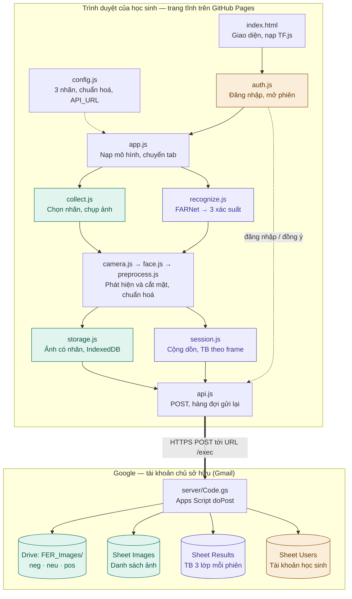

# Ứng dụng giám sát học tập – Trường THPT Kim Liên

Nhận dạng trạng thái học tập (**Tiêu cực / Bình thường / Tích cực**) qua biểu cảm khuôn mặt, chạy hoàn toàn trên trình duyệt bằng TensorFlow.js, kèm chức năng thu thập ảnh có gán nhãn để huấn luyện lại mô hình. Dữ liệu được lưu vào Google Sheet và Google Drive thông qua Google Apps Script.

- Ứng dụng: <https://duongthanglong.github.io/thpt_kimlien/>
- Mã nguồn: <https://github.com/duongthanglong/thpt_kimlien>

## 1. Cấu trúc file

```
thpt_kimlien/
├── index.html          Giao diện: đăng nhập → đồng ý tham gia → 2 tab Giám sát học tập | Thu thập dữ liệu
├── css/style.css       Giao diện theo nhận diện Trường THPT Kim Liên
├── js/
│   ├── config.js       ★ Cấu hình: API_URL, 3 nhãn, chuẩn hoá, tham số chụp/nhận dạng
│   ├── app.js          Điểm vào, điều phối luồng chạy
│   ├── auth.js         Đăng nhập (sheet Users), xác nhận đồng ý tham gia (học sinh + phụ huynh)
│   ├── api.js          Gửi POST tới Apps Script (+ sendBeacon khi đóng tab)
│   ├── camera.js       Webcam
│   ├── face.js         Phát hiện khuôn mặt – MediaPipe BlazeFace
│   ├── preprocess.js   Cắt mặt vuông (+20%), resize, chuẩn hoá → tensor [1,70,70,3]
│   ├── collect.js      Tab Thu thập: chọn nhãn, chụp 1/liên tiếp, xem lại, xoá
│   ├── storage.js      Hàng đợi ảnh trong IndexedDB, gửi theo lô, xuất ZIP
│   ├── recognize.js    Tab Giám sát: mô hình FARNet (TF.js graph model), làm mượt hiển thị
│   ├── session.js      Phiên đăng nhập (buổi học), cộng dồn xác suất, đồng bộ sheet Results
│   └── ui.js           Vẽ khung mặt, thanh xác suất, thông báo
├── models/fer/
│   ├── model.json                  Kiến trúc FARNet (đầu vào 70×70×3, đầu ra 3 lớp)
│   └── group1-shard{1,2,3}of3.bin  Trọng số (~10,7 MB)
└── server/Code.gs      Backend Google Apps Script (dán vào Apps Script của Google Sheet)
```

## 2. Sơ đồ kết nối và luồng hoạt động



Màu trong sơ đồ: **cam** = đăng nhập, **xanh lá** = thu thập dữ liệu, **tím** = giám sát học tập.

**Luồng đăng nhập.** `auth.js` gửi mã học sinh + mật khẩu → `Code.gs` đối chiếu sheet **Users** → trả về `token` (hạn 6 giờ). Nếu cột `dongYThamGia` chưa là TRUE, app hiện phiếu đồng ý (học sinh + phụ huynh); xác nhận xong server ghi TRUE và thời điểm. Mọi thao tác ghi sau đó đều phải kèm `token` hợp lệ.

**Luồng giám sát học tập** (ảnh không rời khỏi máy học sinh):
1. ~10 lần/giây: `face.js` tìm mặt lớn nhất → `preprocess.js` cắt vuông, resize 70×70, chuẩn hoá → `recognize.js` chạy FARNet → 3 xác suất (softmax).
2. `session.js` cộng dồn vector xác suất của các frame **có mặt**; trung bình phiên = tổng ÷ số frame.
3. Mỗi 30 giây, khi đăng xuất và khi đóng tab, kết quả được ghi (cập nhật cùng một dòng theo `sessionId`) vào sheet **Results**, trạng thái `mở` → `đang chạy` → `hoàn tất` / `đóng tab`.

**Luồng thu thập dữ liệu:**
1. Học sinh chọn nhãn, chụp (chỉ chụp khi có đúng 1 khuôn mặt đủ lớn) → ảnh mặt 224×224 JPEG vào hàng đợi IndexedDB (không mất khi rớt mạng hay tải lại trang).
2. `storage.js` gửi theo lô 5 ảnh → `Code.gs` lưu file vào **Drive `FER_Images/<nhãn>/`** rồi ghi 1 dòng vào sheet **Images** (kèm fileId, link). Ảnh gửi lặp được tự bỏ qua theo `imageId`.

## 3. Dữ liệu lưu trên Google

| Nơi lưu | Cột / nội dung |
|---|---|
| Sheet **Users** | `userId` (mã HS) · `hoTen` · `lop` · `matKhau` (lưu rõ – giai đoạn thử nghiệm) · `dongYThamGia` · `thoiDiemDongY` · `ghiChu` |
| Sheet **Images** | `imageId` · `tenFile` · `fileId` · `link` · `nhan` · `userId` · `lop` · `sessionId` · `thoiDiemChup` · `faceW` · `faceH` · `doTinCay` · `thietBi` · `trangThai` (`hợp lệ` / sửa thành `loại`) · `thoiDiemLuu` |
| Sheet **Results** | `sessionId` · `userId` · `hoTen` · `lop` · `batDau` · `capNhatCuoi` · `trangThai` · `soFrame` · `TB Tiêu cực` · `TB Bình thường` · `TB Tích cực` · `nhanTroi` · `thietBi` |
| Drive **FER_Images/** | Thư mục con `neg/`, `neu/`, `pos/`; tên file `nhan_userId_thoidiem_ma.jpg` |

## 4. Hướng dẫn cài đặt từ đầu đến cuối

### Bước 0 – Chuẩn bị
- Một **tài khoản Gmail cá nhân** để chứa Sheet, Drive và Apps Script. Không dùng tài khoản Workspace của cơ quan (`@...edu.vn`) vì quản trị viên thường chặn quyền truy cập “Bất kỳ ai” và chặn script chưa xác minh.
- Một **tài khoản GitHub**.
- Trình duyệt **Chrome hoặc Edge**. Nên dùng một cửa sổ (profile) chỉ đăng nhập đúng tài khoản Gmail ở trên, tránh lỗi `/u/1/` khi nhiều tài khoản cùng đăng nhập.

### Bước 1 – Đưa mã nguồn lên GitHub
1. GitHub → **New repository** → tên `thpt_kimlien` → chọn **Public** → *Create repository*.
2. Giải nén gói mã nguồn, mở thư mục `thpt_kimlien`, chọn **toàn bộ nội dung bên trong** (`index.html`, `README.md`, `css`, `js`, `models`, `server`).
3. Trên repo: **Add file → Upload files** → **kéo thả** cả nhóm vào ô tải lên (nút “choose your files” không chọn được thư mục; kéo thả thì giữ nguyên cấu trúc) → **Commit changes**.
4. Kiểm tra: trang chính của repo phải thấy `index.html` ở gốc và các thư mục `css/`, `js/`, `models/fer/`, `server/`.

### Bước 2 – Tạo Google Sheet và Apps Script
1. Đăng nhập Gmail, mở <https://sheets.new>, đặt tên bảng tính (vd. `KimLien_GiamSatHocTap`).
2. Menu **Tiện ích mở rộng → Apps Script**. Xoá code mặc định, dán toàn bộ `server/Code.gs` (trên GitHub mở file → nút **Raw** → chép). Bấm **Lưu**.
3. Nếu đổi tên/thứ tự nhãn, sửa `CFG.LABELS` ở đầu file cho khớp `js/config.js`.

### Bước 3 – Chạy `setup()` và cấp quyền
1. Trên thanh công cụ Apps Script chọn hàm **`setup`** → **Chạy**.
2. Hộp thoại cấp quyền: bấm **Xem lại quyền** → chọn tài khoản Gmail → màn hình “Google chưa xác minh ứng dụng này” → **Nâng cao** → **Truy cập … (không an toàn)** → đánh dấu **tất cả** các quyền (Sheets, Drive) → **Cho phép**.
3. Nhật ký thực thi hiện `Đã tạo sheet. Thư mục ảnh: …`. Kết quả: 3 trang **Users, Images, Results**, tài khoản mẫu `demo / 123456`, thư mục Drive **FER_Images**.

### Bước 4 – Triển khai ứng dụng web
1. **Triển khai → Tùy chọn triển khai mới →** biểu tượng bánh răng → **Ứng dụng web**.
2. **Thực thi với tư cách: Tôi** · **Người có quyền truy cập: Bất kỳ ai** (không chọn “Chỉ mình tôi” hay “Bất kỳ ai có Tài khoản Google” – app trên GitHub sẽ không gọi được).
3. **Triển khai** → sao chép **URL ứng dụng web**. Nếu URL có đoạn `/u/0/` hoặc `/u/1/` thì **xoá đoạn đó**; dạng đúng: `https://script.google.com/macros/s/<mã-dài>/exec`.
4. Kiểm tra: mở URL trong **cửa sổ ẩn danh** (Ctrl+Shift+N) → phải thấy
   `{"ok":true,"app":"FER API","labels":["Tiêu cực","Bình thường","Tích cực"]}`.

> Sheet và thư mục Drive **vẫn riêng tư**. “Bất kỳ ai” chỉ là quyền gọi URL `/exec`; script chạy bằng quyền của chủ sở hữu, mọi thao tác ghi đều phải đăng nhập theo sheet Users.

### Bước 5 – Cấu hình app (`js/config.js`)
Trên GitHub mở `js/config.js` → biểu tượng bút chì → sửa → **Commit changes**:

| Tham số | Giá trị | Ghi chú |
|---|---|---|
| `API_URL` | URL `/exec` ở Bước 4 | Giữ nguyên dấu nháy |
| `LABELS` | Tiêu cực (`neg`) · Bình thường (`neu`) · Tích cực (`pos`) | **Đúng thứ tự đầu ra của mô hình**; đồng bộ với `CFG.LABELS` trong Code.gs |
| `NORMALIZE` | `'0_1'` (chia 255) | Phải trùng cách chuẩn hoá lúc huấn luyện: `'0_1'`, `'-1_1'`, `'imagenet'` hoặc `'none'` |
| `FACE_MARGIN` | `0.2` | Nới khung mặt 20% trước khi cắt vuông |
| `INFER_FPS` · `CHECKPOINT_SEC` | `10` · `30` | Số frame/giây và chu kỳ lưu kết quả lên sheet |
| `BURST_COUNT` · `UPLOAD_BATCH` | `5` · `5` | Số ảnh mỗi lần chụp liên tiếp và mỗi lô gửi |

### Bước 6 – Bật GitHub Pages
1. Repo → **Settings → Pages** → *Source*: **Deploy from a branch** → Branch **`main`**, thư mục **`/ (root)`** → **Save**.
2. Sau 1–2 phút, app chạy tại `https://duongthanglong.github.io/thpt_kimlien/`. Mỗi lần commit, Pages tự cập nhật sau 1–2 phút (bấm **Ctrl+F5** để tải bản mới).

### Bước 7 – Tạo tài khoản học sinh
Mở trang **Users**, mỗi học sinh một dòng:

| userId | hoTen | lop | matKhau | dongYThamGia | thoiDiemDongY | ghiChu |
|---|---|---|---|---|---|---|
| KL10A1001 | Nguyễn Văn An | 10A1 | 482913 | FALSE | | |

- Có thể dán cả danh sách từ Excel. Cột `matKhau` đã định dạng văn bản (giữ số 0 đầu).
- Để `dongYThamGia` = FALSE; app tự chuyển TRUE khi học sinh xác nhận phiếu đồng ý. Nên thu thêm phiếu đồng ý giấy có chữ ký phụ huynh qua giáo viên chủ nhiệm.
- Xoá hoặc đổi mật khẩu tài khoản `demo` khi dùng thật.

### Bước 8 – Chạy thử toàn bộ
1. Mở app → đăng nhập `demo / 123456` → hiện phiếu đồng ý → đánh dấu 2 ô → **Xác nhận** → cho phép trình duyệt dùng **camera**.
   → Sheet **Results** có dòng mới, trạng thái `mở`; sheet **Users** dòng demo có `dongYThamGia` = TRUE.
2. Tab **Giám sát học tập** → *Bắt đầu giám sát* → khung mặt và 3 thanh xác suất hiện ra. Sau ~30 giây dòng Results chuyển `đang chạy`, có `soFrame` và 3 cột trung bình.
3. Tab **Thu thập dữ liệu** → chọn nhãn → *Chụp liên tiếp (5)* → ảnh lên sheet **Images** và thư mục **FER_Images/<nhãn>/** (huy hiệu số ảnh chờ gửi trên thanh tiêu đề về 0).
4. **Đăng xuất** → dòng Results chuyển `hoàn tất`.

### Bước 9 – Vận hành và cập nhật
- **Xem kết quả theo lớp/học sinh:** sheet Results → *Dữ liệu → Tạo bộ lọc*, lọc cột `lop`, `userId`; hoặc dùng Bảng tổng hợp (pivot) theo lớp.
- **Loại ảnh xấu:** sheet Images → đổi `trangThai` thành `loại` (không cần xoá file).
- **Học sinh rút khỏi nghiên cứu:** lọc `userId` trong Images → xoá file Drive theo `link` → xoá các dòng tương ứng trong Images và Results → đặt `dongYThamGia` = FALSE.
- **Xuất dữ liệu huấn luyện:** *Tệp → Tải xuống → CSV* sheet Images (lọc `trangThai = hợp lệ`) + tải thư mục FER_Images; chia train/test **theo `userId`**.
- **Sửa `Code.gs`:** lưu → **Triển khai → Quản lý triển khai** → bút chì → *Phiên bản: Phiên bản mới* → **Triển khai** (URL giữ nguyên; tạo “triển khai mới” sẽ ra URL khác).
- **Thay mô hình:** ghi đè `models/fer/model.json` và các file `.bin`; nếu đổi số lớp/kích thước đầu vào thì sửa `LABELS`, `INPUT_SIZE` (config.js) và `CFG.LABELS` (Code.gs), rồi chạy lại `setup()` để cập nhật tiêu đề cột Results.

### Bước 10 – Xử lý sự cố

| Hiện tượng | Nguyên nhân / cách xử lý |
|---|---|
| Mở URL `/exec` báo “Sorry, unable to open the file…” | URL có `/u/1/` (nhiều tài khoản Google) → xoá đoạn `/u/1`, thử lại trong cửa sổ ẩn danh |
| Đăng nhập báo “Failed to fetch” / “Lỗi máy chủ” | Bước 4 chưa chọn **Bất kỳ ai**, hoặc `API_URL` sai / là URL `/dev` |
| “Chưa cấu hình API_URL trong js/config.js” | Chưa sửa config.js hoặc Pages chưa cập nhật → chờ 1–2 phút, Ctrl+F5 |
| “Chưa có sheet …” | Chưa chạy `setup()` hoặc Code.gs gắn với Sheet khác |
| “Ứng dụng này bị chặn” khi cấp quyền | Đang dùng tài khoản Workspace cơ quan → làm lại bằng Gmail cá nhân |
| Không mở được camera | Chưa cho phép quyền camera (biểu tượng ổ khoá trên thanh địa chỉ), hoặc camera đang bị ứng dụng khác dùng |
| “Phiên đăng nhập hết hạn” | Token quá 6 giờ không hoạt động → đăng nhập lại |
| Sửa Code.gs nhưng không có tác dụng | Chưa tạo **Phiên bản mới** trong *Quản lý triển khai* |
| Kết quả nhận dạng lệch hẳn về một lớp | Kiểm tra `NORMALIZE` và thứ tự `LABELS` có trùng lúc huấn luyện |

## 5. Lưu ý
- **Quyền riêng tư:** ở chức năng giám sát, hình ảnh chỉ xử lý trên máy học sinh; chỉ lưu xác suất trung bình mỗi buổi. Ảnh khuôn mặt chỉ được lưu ở chức năng thu thập, sau khi học sinh (và phụ huynh) đồng ý.
- **Repo công khai:** mã nguồn và trọng số mô hình tải về được. Không đưa ID Sheet, mật khẩu hay thông tin bí mật vào repo.
- **Mật khẩu lưu rõ** trong sheet Users chỉ phù hợp giai đoạn thử nghiệm; không chia sẻ Sheet cho người ngoài nhóm quản lý.
- **Giới hạn Apps Script:** đủ cho một lớp vài chục học sinh dùng cùng lúc; ảnh chưa gửi được giữ trong trình duyệt và tự gửi lại.
